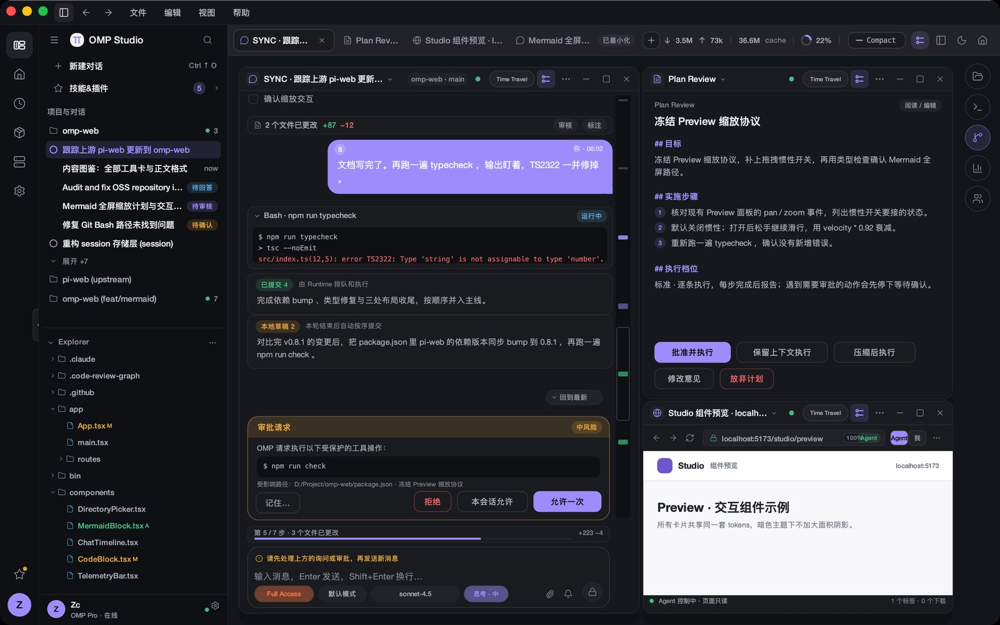
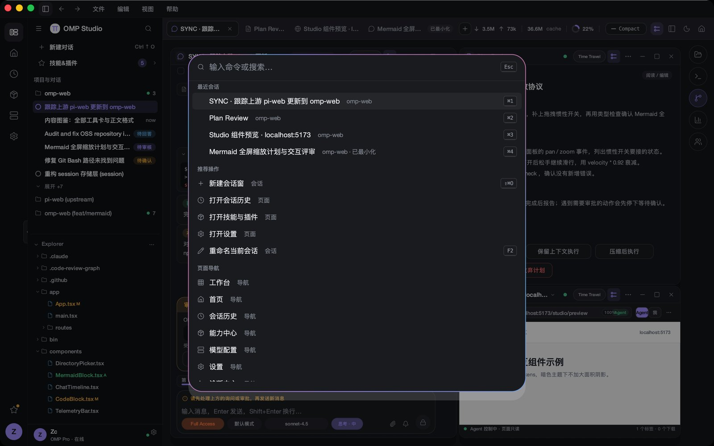

# OmpStudioMoui

**用 MoonBit + MoUI 手绘复刻的 OMP Studio 工作台**。同一份代码跑两个平台：macOS 原生（Skia）与浏览器（wasm-gc，优先 WebGPU，不支持时自动降级 Canvas2D）。

[](https://github.com/wzzc-dev/OmpStudioMoui/actions/workflows/pages.yml)

**在线预览（web 构建）：<https://wzzc-dev.github.io/OmpStudioMoui/>**



## 这是什么

OMP Studio 是一个 Electron + React 的桌面 AI 工作台（参考版本 v0.2.8，渲染层有 49 个功能目录、约 20 万行 TypeScript）。本项目不是主题皮肤，而是把它的**壳层、交互和页面**用 MoonBit 重新实现一遍：

- **整块界面是一张 canvas**，没有 DOM 控件。布局、文字测量、命中测试、焦点环、hover/press、tooltip、toast、模态、拖拽全部自绘，`app/` 里没有一行 HTML。
- **尺寸、颜色、文案以参考源码为 ground truth**。三份规格（[尺寸结构](design/inventory.md)、[设计 token](design/tokens.md)、[中文文案](design/copy.md)）每条都标了参考文件的出处，改视觉先改规格再改代码。
- **目标是功能也真，不只是像**：窗口系统、页面路由、⌘K 命令目录、审批/计划决议、主题与信息密度都是真实状态机，不是贴图。

当前进度（唯一口径见 [docs/roadmap.md](docs/roadmap.md)）：

| 层 | 状态 | 说明 |
|---|---|---|
| 窗口系统 | ✅ 真交互 | 拖拽、八向缩放、6 种吸附、最大化/最小化/关闭、z 序、布局预设、Tab 切换与关闭 |
| 工作台壳 | ✅ 视觉对齐 + 交互 | 36px 自绘标题栏、44px 顶栏、56px 图标栏、272px 会话侧栏（可拖 200–400）、Explorer 46:54 分割、右缘工具坞 |
| 二级页面 | ✅ 10 页 + 页内交互 | 首页 / 历史 / 能力中心 / 模型配置 / 设置 / 诊断 / 评测 / 媒体 / 统计 / Agent Hub |
| 命令面板 | ✅ ⌘K | 42 条命令分 5 组、过滤、↑↓/Home/End/⌘1..9/⏎/Esc、hover 移位高亮 |
| 交互层 | ✅ | hover/press tint、2px 焦点环、Tab/方向键环走、Esc 逐层、500ms tip、3s toast、3 张模态、侧栏/分割拖拽 |
| 会话窗 | 🟡 行为本地状态 | 消息流、工具卡、审批卡、composer 是 mock 数据，发送只是本地追加 |
| 数据层 | ⬜ 未开始 | 所有内容来自 `demo_*` 常量，没有持久化，也没有接真实宿主进程 |



## 架构

```
MoonBit (wasm-gc / native)
        │
   @moui.Program[Model, Msg]   ← reducer：update(model, msg) -> model
        │                         view(model) 只是一张全尺寸 canvas
   app/  （纯逻辑 + 绘制，不依赖平台）
        │
   ┌────┴───────────────────────────────┐
 macos_skia/                          web_wasm/
 （原生入口，Skia 渲染，窗口 1440×900） （浏览器入口，wasm-gc）
```

- `app/`：唯一有内容的包。`model.mbt` 状态、`input.mbt` 指针/键盘 reducer、`interact.mbt` 可达控件表与焦点环、`geometry/layout` 尺寸、`panels/pages/scene` 绘制。
- 控件表 `controls()` 每帧生成矩形，绘制、命中、焦点、tooltip 都读同一份几何，所以「画得到的地方才点得到」是结构保证。
- 平台入口只负责把宿主事件翻译成 `Msg`；`macos_skia/` 用 Skia + 原生窗口，`web_wasm/` 导出 wasm 供 `runtime.js` 驱动。

目录：

| 路径 | 内容 |
|---|---|
| `app/` | 复刻的全部实现（约 12.8k 行 MoonBit） |
| `macos_skia/` | macOS 原生入口（透明标题栏，窗口默认 1440×900） |
| `web_wasm/` | 浏览器入口与 `index.html` 模板 |
| `design/` | 尺寸结构、token、文案规格（视觉 ground truth） |
| `docs/roadmap.md` | 分阶段功能清单与进度记录 |
| `scripts/shot.sh` | 构建/启动后只截应用窗口，校验窗口 id 与截图像素尺寸 |
| `scripts/check.sh` | 上述流程 + 5 秒存活检查（原生回归门禁） |
| `scripts/build-site.sh` | 把 wasm 构建拼成可托管的静态站点 |
| `.github/workflows/pages.yml` | CI：构建 web 并部署 GitHub Pages |

## 跑起来

前置：安装 [MoonBit CLI](https://www.moonbitlang.com/download/)（`moon`，本项目用 0.1.20261119 验证）。原生平台额外需要 macOS + Xcode Command Line Tools。

```sh
moon update          # 拉取 mooncakes 依赖（moui / moui_web_renderer / moui_skia_renderer / window）
```

### 浏览器

```sh
moon build web_wasm --target wasm-gc
scripts/build-site.sh --no-build
python3 -m http.server 8099 -d _site
# 打开 http://127.0.0.1:8099/
```

WebGPU 可用时走 GPU；不可用时 `runtime.js` 自动改走 Canvas2D，所以普通 Chrome/Edge/Safari 都能跑。首次加载要下载约 2MB 的 wasm。

### macOS 原生

```sh
moon run macos_skia --target native
```

`OMP_WIN_W=1600 OMP_WIN_H=1000 moon run macos_skia --target native` 可以换窗口尺寸；`OMP_ROUTE=statistics` 直接开某个二级页面。

## 测试与视觉回归

```sh
moon test app --target native   # 25 条 reducer / 布局测试
moon check app --target native  # 0 errors
scripts/check.sh                # 构建 + 启动 + 截图 + 5s 存活检查（退出码 0 才算过）
```

QA 开关（都在启动时读环境变量）：`OMP_ROUTE=<slug>` 指定起始页面，`OMP_PALETTE=1` 打开 ⌘K，`OMP_MODAL=confirm|rename|shortcuts` 预置模态，`OMP_FOCUS=1` 显示焦点环，`OMP_HOVER_X/Y` 停指针以捕获 hover/tip。截图由 `scripts/shot.sh` 只截应用窗口，脚本会校验窗口 id 与截图像素尺寸。

## 部署

推送到 `main` 或手动触发 workflow 即可；CI 在 Ubuntu 上安装 MoonBit、构建 wasm-gc、`scripts/build-site.sh` 拼出 `_site/`，再由 `actions/deploy-pages` 发布。

仓库 Settings → Pages → Source 选 **GitHub Actions**（首次部署前需要一次）。站点是纯静态，路径全相对，放在项目子路径下也能用。

## 参考与致谢

复刻对象为 OMP Studio v0.2.8 的渲染层。参考源码不随本仓库分发；本文档里的尺寸、颜色、文案引用只用于对齐实现。
